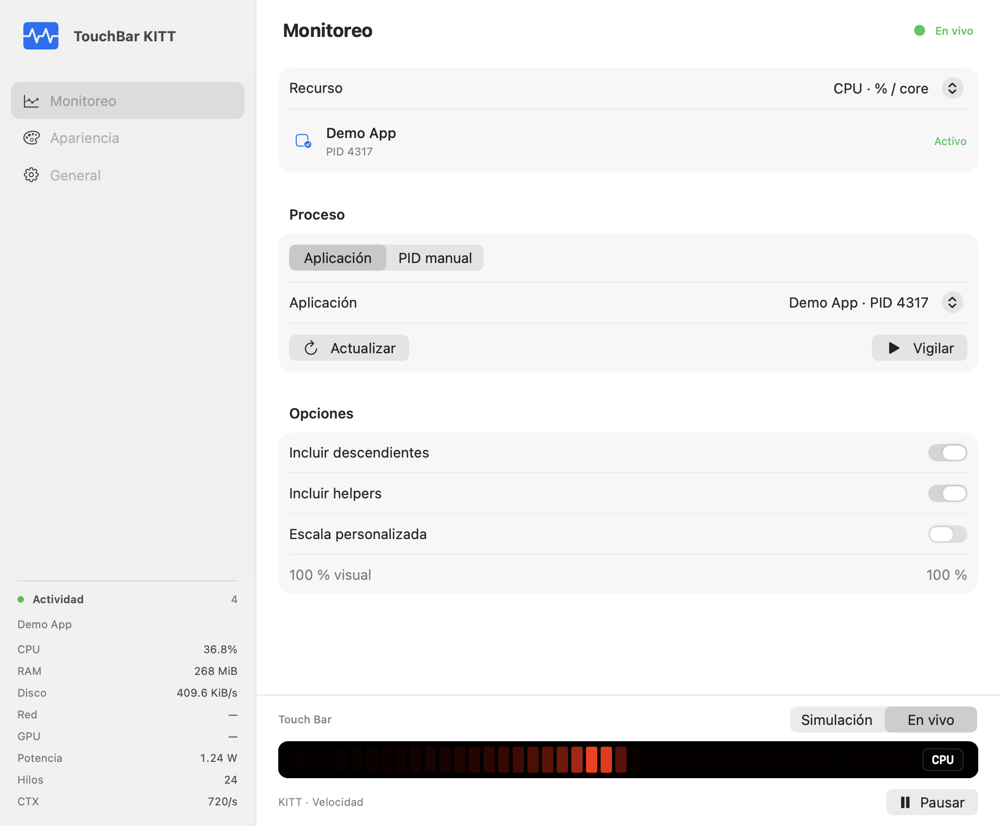
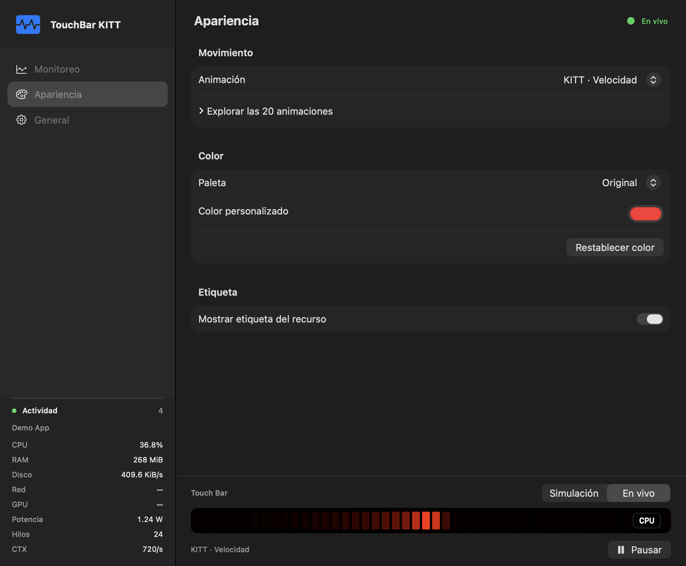
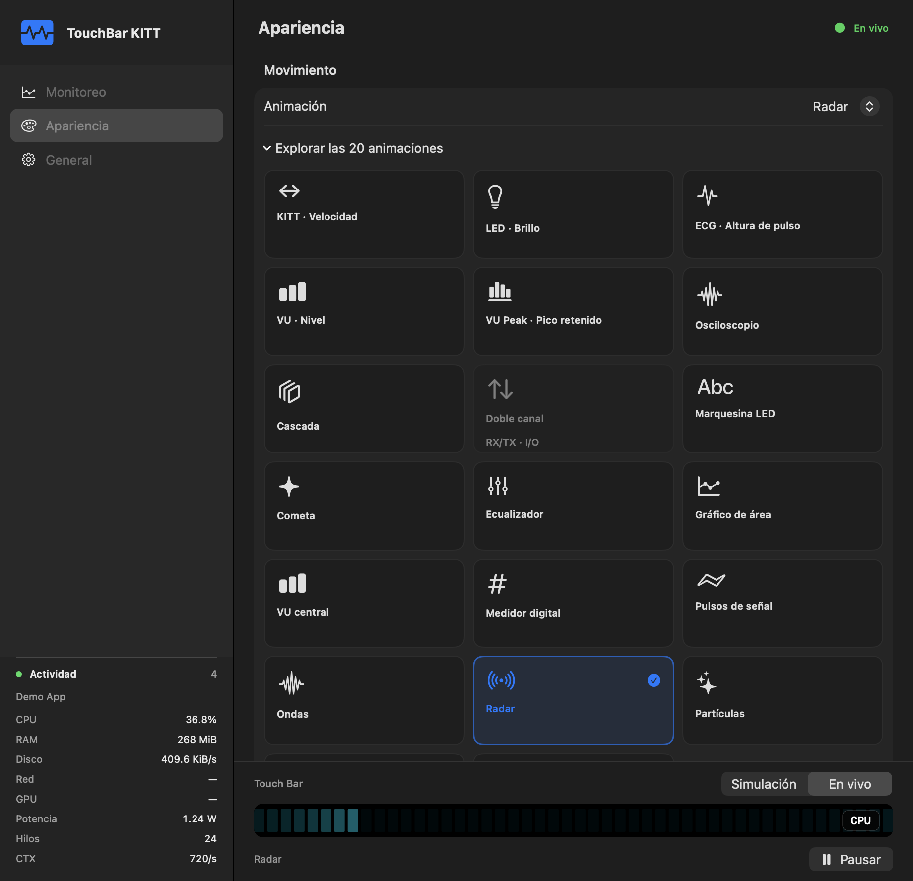

# TouchBar KITT

[English](README.md) · **Español**

Una aplicación de barra de menús para macOS que convierte la Touch Bar en un monitor de recursos en vivo. Sigue una aplicación o proceso y visualiza su actividad con 20 animaciones y colores personalizables.



## Funciones

- Monitoreo de una aplicación o un PID manual, con descendientes y helpers opcionales.
- Lecturas de CPU, actividad de memoria, disco, red, GPU, potencia, hilos y cambios de contexto.
- 20 animaciones, paletas de color y selector de color personalizado.
- Lecturas en vivo en la barra lateral y vista previa de la Touch Bar al pie de la ventana.
- Sensibilidad ajustable y vista previa en vivo o con carga simulada.
- Apariencia clara y oscura nativa, inglés y español e inicio automático al iniciar sesión.

## Requisitos

- MacBook Pro con Touch Bar física.
- macOS 13 o posterior.
- Xcode o Xcode Command Line Tools para compilar la aplicación.

## Compilar y ejecutar

```bash
git clone https://github.com/scrntprcrz/touchbar-kitt.git
cd touchbar-kitt
./build.sh
./start.sh
```

La compilación genera `build/TouchBarKITT.app`. Puedes copiarla a `/Applications` o abrir `TouchBarKITT.xcodeproj` en Xcode.

## Uso

1. Abre **Configuración** desde el icono de la barra de menús.
2. En **Monitoreo**, elige un recurso y selecciona una aplicación o introduce un PID; después pulsa **Vigilar**.
3. En **Apariencia**, selecciona la animación, el color y la etiqueta del recurso.
4. En **General**, cambia el idioma o activa el inicio automático.

Cerrar la ventana de configuración mantiene el monitoreo activo. Usa **Pausar** para detenerlo o **Salir de TouchBar KITT** para cerrar la aplicación.

## Métricas

| Recurso | Lectura |
| --- | --- |
| CPU | Uso de CPU de la familia de procesos; 100 % corresponde a un núcleo |
| Memoria | Cambio absoluto de memoria residente por segundo |
| Disco | Lecturas y escrituras combinadas |
| Red | Recepción y envío combinados |
| GPU | Estimación de actividad de ejecución en GPU |
| Potencia | Consumo de potencia estimado del proceso |
| Hilos | Hilos activos en la familia de procesos |
| Cambios de contexto | Cambios de contexto del planificador por segundo |

La sensibilidad personalizada ajusta la escala visual. La lectura de RAM en la barra lateral muestra la memoria residente ocupada.

## Animaciones

KITT, LED, ECG, VU, VU con pico, Osciloscopio, Cascada, Doble canal, Marquesina LED, Cometa, Ecualizador, Gráfico de área, VU central, Medidor digital, Pulsos de señal, Ondas, Radar, Partículas, Respiración y KITT doble.

Doble canal está disponible para la actividad de disco y red.

| Apariencia | Galería de animaciones |
| --- | --- |
|  |  |

## Compatibilidad

La presentación global de la Touch Bar utiliza APIs privadas de macOS y puede cambiar con las actualizaciones del sistema. Las lecturas de red y GPU pueden no estar disponibles para algunos procesos; el monitoreo de GPU es experimental. El ancho disponible en la Touch Bar depende de la distribución del sistema.

## Desarrollo

La aplicación utiliza SwiftUI, AppKit y contadores nativos de procesos, sin dependencias de ejecución de terceros.

```bash
./bin/test-models.sh
./bin/test-rendering.sh
```

Las pruebas de renderizado requieren una sesión gráfica de macOS.

## Licencia

Distribuido bajo la [licencia MIT](LICENSE).
