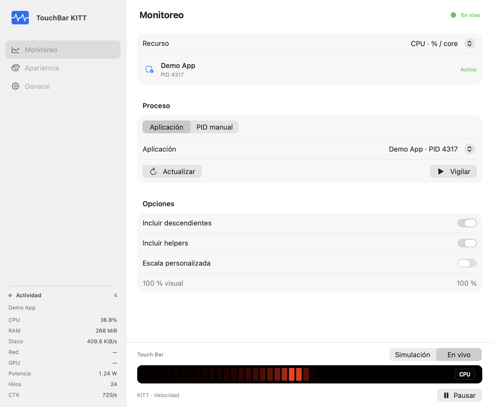
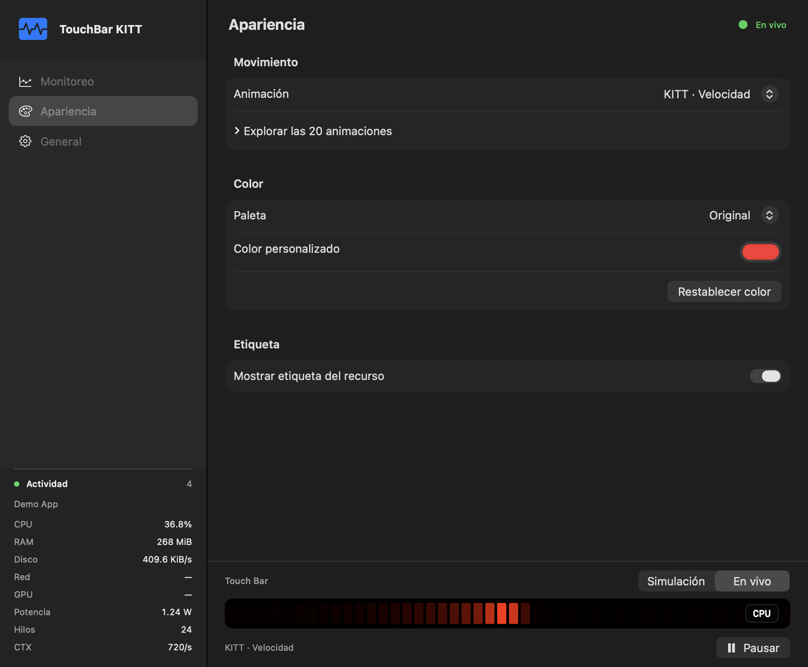
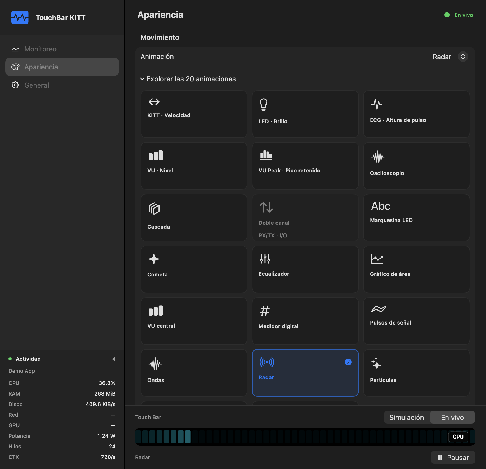

# TouchBar KITT

**English** · [Español](README.es.md)

A macOS menu bar app that turns the Touch Bar into a live resource monitor. Follow an application or process and visualize its activity with 20 animations and customizable colors.



## Features

- Monitor an application or a manual PID, with optional child and helper processes.
- Track CPU, memory activity, disk, network, GPU, power, threads, and context switches.
- Choose from 20 animations, color palettes, and a custom color picker.
- Keep live readings in the sidebar and preview the Touch Bar at the bottom of the window.
- Adjust sensitivity and switch between live activity and a simulated preview.
- Native light and dark appearance, English and Spanish, and optional launch at login.

## Requirements

- A MacBook Pro with a physical Touch Bar.
- macOS 13 or later.
- Xcode or Xcode Command Line Tools to build the app.

## Build and run

```bash
git clone https://github.com/scrntprcrz/touchbar-kitt.git
cd touchbar-kitt
./build.sh
./start.sh
```

The build creates `build/TouchBarKITT.app`. You can copy it to `/Applications` or open `TouchBarKITT.xcodeproj` in Xcode.

## Usage

1. Open **Settings** from the menu bar icon.
2. In **Monitor**, choose a resource and select an application or enter a PID, then click **Watch**.
3. In **Appearance**, choose an animation, color, and resource label.
4. Use **General** to change the language or enable launch at login.

Closing the settings window keeps monitoring active. Use **Pause** to stop monitoring or **Quit TouchBar KITT** to exit the app.

## Metrics

| Metric | Measurement |
| --- | --- |
| CPU | CPU usage across the process family; 100% corresponds to one core |
| Memory | Absolute change in resident memory per second |
| Disk | Combined read and write throughput |
| Network | Combined receive and transmit throughput |
| GPU | Estimated GPU execution activity |
| Power | Estimated process power consumption |
| Threads | Active threads in the process family |
| Context switches | Scheduler context switches per second |

Custom sensitivity changes the visual scale. Live RAM readings in the sidebar show resident memory usage.

## Animations

KITT, LED, ECG, VU, VU Peak, Oscilloscope, Waterfall, Dual-channel, LED Marquee, Comet, Equalizer, Filled Graph, Center VU, Digital Meter, Signal Pulses, Waves, Radar, Particles, Breathe, and Twin KITT.

Dual-channel is available for disk and network activity.

| Appearance | Animation gallery |
| --- | --- |
|  |  |

## Compatibility

Global Touch Bar presentation uses private macOS APIs and may change with system updates. Network and GPU readings may be unavailable for some processes; GPU monitoring is experimental. The available Touch Bar width depends on the system layout.

## Development

The app uses SwiftUI, AppKit, and native process counters, with no third-party runtime dependencies.

```bash
./bin/test-models.sh
./bin/test-rendering.sh
```

The rendering tests require a graphical macOS session.

## License

Licensed under the [MIT License](LICENSE).
